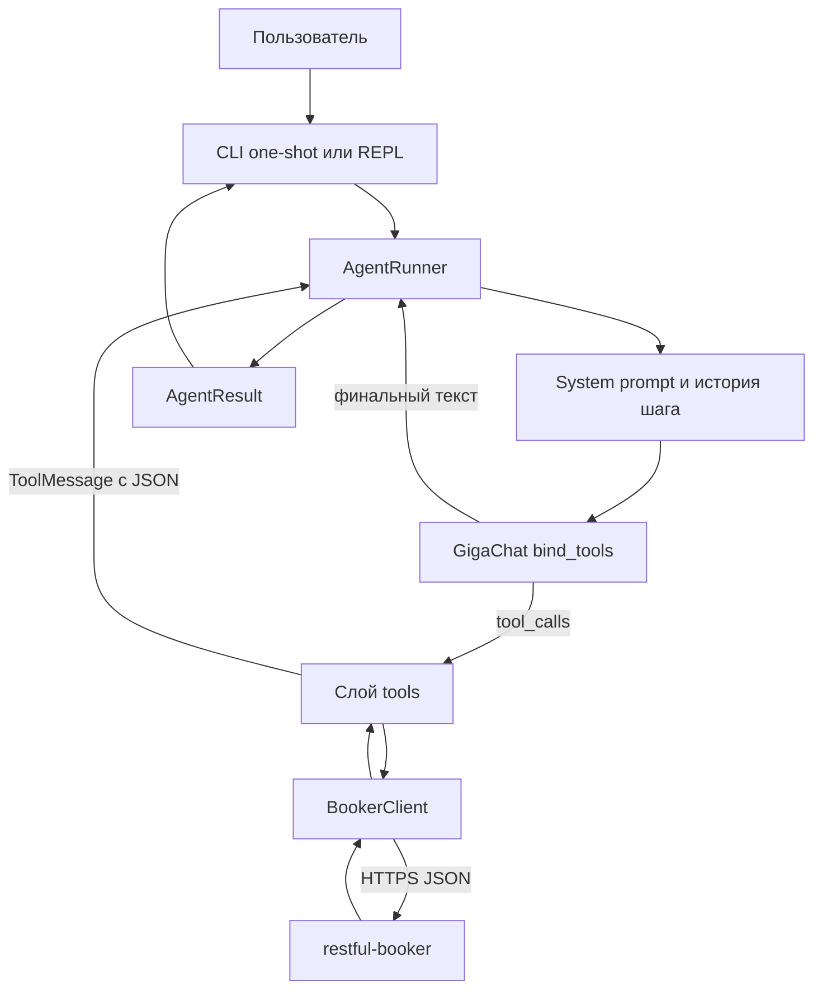
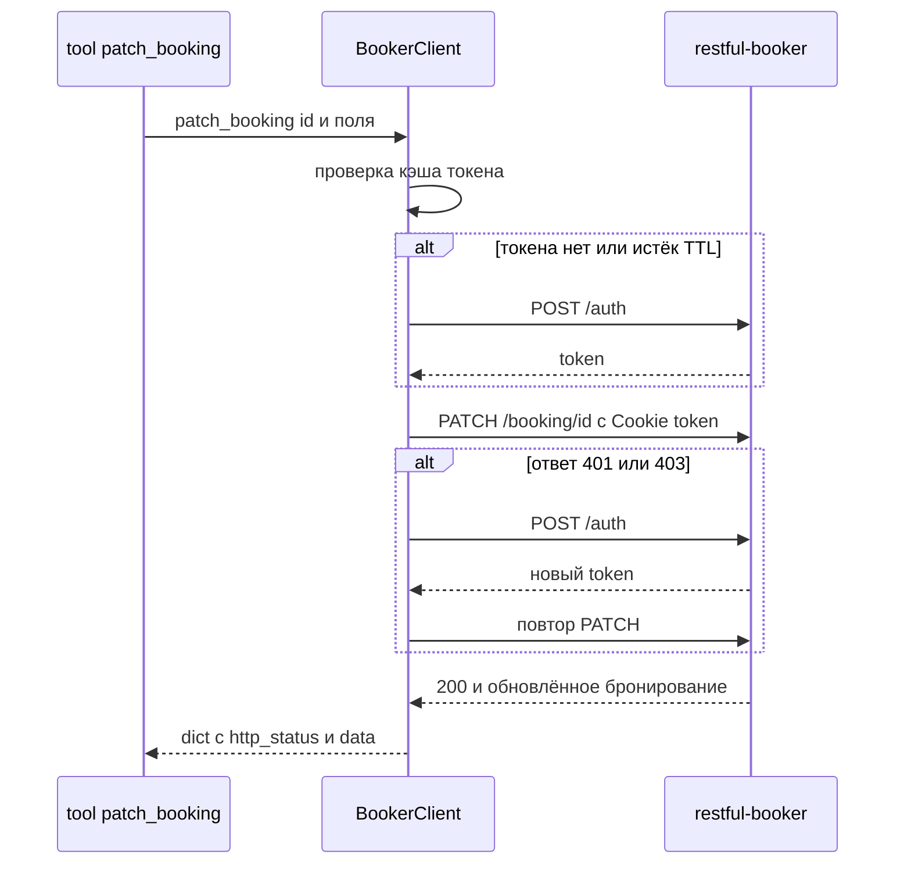

# План: минимальный AI-агент на LangChain как NL-обёртка над restful-booker API

## 1. Цель и границы

Создать консольного агента на Python, который принимает запрос на естественном языке, интерпретирует намерение через LLM (GigaChat), вызывает нужные методы API `https://restful-booker.herokuapp.com/` через LangChain tools и возвращает структурированный результат со статусом выполнения.

Входит в объём:
- CLI с двумя режимами: one-shot (`booker "текст"`) и интерактивный REPL.
- 6 операций API из задания + health-check.
- Авторизация API (получение и кэширование токена) для PATCH/DELETE.
- Единый структурированный ответ: `status`, `operation`, `http_status`, `data`, `summary`, `tool_calls`, `error`.
- Обработка ошибок: 404, 401/403, 400/422, 5xx, таймауты, недоступность API.
- Юнит-тесты без сети и отдельный live smoke-прогон.

Не входит в объём:
- Веб-интерфейс, FastAPI, БД, история диалогов между запусками.
- Многоагентность, RAG, память в векторном сторе.
- Работа с другими API.

## 2. Ключевые технические факты, влияющие на дизайн

### restful-booker
| Операция | Метод и путь | Особенности |
|---|---|---|
| Список ID | `GET /booking` | Возвращает `[{"bookingid": 1}, ...]`; поддерживает фильтры `firstname`, `lastname`, `checkin`, `checkout` |
| Бронирование по ID | `GET /booking/{id}` | Заголовок `Accept: application/json` обязателен, иначе ответ не JSON; отсутствующий ID → `404` |
| Создание | `POST /booking` | Успех возвращает `200` (не `201`) с `{"bookingid": N, "booking": {...}}` |
| Частичное обновление | `PATCH /booking/{id}` | Нужен `Cookie: token=<token>`, успех `200`, тело — только изменяемые поля |
| Полное обновление | `PUT /booking/{id}` | Нужен токен, успех `200`; полезно для сценария «измени всё» |
| Удаление | `DELETE /booking/{id}` | Нужен токен, успех `201` с текстом `Created` |
| Health-check | `GET /ping` | Успех `201`; нужен для диагностики холодного старта Heroku |
| Авторизация | `POST /auth` | Тело `{"username": "admin", "password": "password123"}` → `{"token": "..."}`; токен живёт ~10 минут |

Следствия:
- Токен кэшировать в памяти клиента с TTL и обновлять при `401/403` с одним повтором запроса.
- Токен restful-booker и OAuth-ключ GigaChat — разные вещи, в конфиге и документации их нужно явно разделить.
- Heroku может отвечать `502/503` на холодном старте → retry с backoff для `502/503/504/429`.

### GigaChat и langchain-gigachat 0.5.x
- Требуется Python >= 3.10; авторизация через `GIGACHAT_CREDENTIALS` (authorization key), `GIGACHAT_SCOPE` (`GIGACHAT_API_PERS` для физлиц).
- Инструменты подключаются штатно: `@tool` + `llm.bind_tools([...], tool_choice="auto")`.
- `tool_choice="any"` не поддерживается — использовать только `auto`, `none` или имя инструмента.
- Нет параллельных tool calls в одном сообщении ассистента: цикл агента обязан обрабатывать ровно один вызов за шаг, а при нескольких — обрабатывать по одному или возвращать ошибку протокола.
- `with_structured_output` работает через function calling; для финального ответа надёжнее детерминированная сборка результата из трассировки инструментов, чем парсинг свободного текста модели.
- Пакет `langchain-gigachat` 0.5.x рассчитан на ветку LangChain 0.3; при конфликте версий с `langchain-core` 1.x использовать `langchain-gigachat-lc1`. Проверка совместимости — первый шаг реализации.

## 3. Архитектура





Почему ручной цикл tool calling, а не `AgentExecutor`:
- `AgentExecutor` из пакета `langchain` в новых версиях устарел, а ручной цикл требует только `langchain-core`.
- Нужен полный контроль над статусом, лимитом шагов, таймаутами и форматом результата.
- GigaChat возвращает не более одного tool call за шаг — простой цикл `while` точнее отражает этот протокол.

## 4. Структура проекта

```
ai-agent/
├── README.md
├── REPORT.md
├── pyproject.toml
├── .env.example
├── .gitignore
├── plans/
│   └── booking-agent-plan.md
├── src/
│   └── booker_agent/
│       ├── __init__.py
│       ├── config.py        # настройки из окружения и .env
│       ├── models.py        # Pydantic-модели домена и результата
│       ├── errors.py        # иерархия исключений и маппинг статусов
│       ├── client.py        # HTTP-клиент restful-booker
│       ├── tools.py         # LangChain @tool обёртки
│       ├── prompts.py       # system prompt и few-shot подсказки
│       ├── agent.py         # цикл tool calling и сборка AgentResult
│       └── cli.py           # argparse, REPL, вывод
└── tests/
    ├── conftest.py
    ├── test_client.py
    ├── test_tools.py
    └── test_agent.py
```

## 5. Стек и зависимости

Базовые:
- `langchain-gigachat>=0.5.1,<0.6` — модель GigaChat для LangChain.
- `langchain-core` — `@tool`, сообщения, `bind_tools` (приходит транзитивно, версию фиксируем после проверки совместимости).
- `httpx>=0.27` — HTTP-клиент с явными таймаутами и удобным мокингом через `respx`.
- `pydantic>=2.7` — валидация аргументов инструментов и доменных моделей.
- `pydantic-settings>=2.2` — чтение `.env`, типизация настроек.
- `rich>=13` — читаемый вывод в REPL и таблица ID.

Dev:
- `pytest`, `pytest-cov`, `respx`, `ruff`.
- `uv` для окружения и запуска (`uv sync`, `uv run booker ...`); альтернатива — `venv` + `pip install -e .`.

Управление зависимостями и точкой входа — через `pyproject.toml` (PEP 621), console script `booker = booker_agent.cli:main`.

## 6. Конфигурация

`.env.example`:

```dotenv
# GigaChat
GIGACHAT_CREDENTIALS=your-authorization-key
GIGACHAT_SCOPE=GIGACHAT_API_PERS
GIGACHAT_MODEL=GigaChat-2
GIGACHAT_VERIFY_SSL_CERTS=true

# restful-booker
BOOKER_BASE_URL=https://restful-booker.herokuapp.com
BOOKER_USERNAME=admin
BOOKER_PASSWORD=password123
BOOKER_TIMEOUT=15
BOOKER_MAX_RETRIES=2

# агент
AGENT_MAX_STEPS=6
AGENT_TEMPERATURE=0.0
AGENT_VERBOSE=false
```

Правила:
- Секреты только через окружение; `.env` в `.gitignore`.
- Токен API и GigaChat-ключ никогда не попадают в логи, в `AgentResult` и в сообщения об ошибках.
- Валидация настроек при старте: при отсутствии `GIGACHAT_CREDENTIALS` — понятная ошибка и код возврата `2`.

## 7. Модели данных

`models.py`:
- `BookingDates`: `checkin`, `checkout` — `date`, с проверкой `checkin < checkout`.
- `Booking`: `firstname`, `lastname`, `totalprice >= 0`, `depositpaid`, `bookingdates`, `additionalneeds` (опционально).
- `BookingUpdate`: все поля опциональны (для PATCH), пустой объект запрещён.
- `BookingCreated`: `bookingid`, `booking`.
- `ToolResult`: `status`, `operation`, `http_status`, `data`, `error`, `message`.
- `AgentResult`: `status`, `operation`, `http_status`, `data`, `summary`, `tool_calls`, `error`.
- `AgentStatus`: `success`, `not_found`, `unauthorized`, `invalid_request`, `server_error`, `network_error`, `needs_clarification`, `max_steps_reached`, `config_error`.

Контракт ответа инструмента (JSON-строка в `ToolMessage`):

```json
{
  "status": "success",
  "operation": "get_booking",
  "http_status": 200,
  "data": {"firstname": "Sally", "lastname": "Brown", "...": "..."},
  "error": null,
  "message": "Бронирование 1 получено"
}
```

Контракт финального результата:

```json
{
  "status": "success",
  "operation": "list_bookings",
  "http_status": 200,
  "data": [{"bookingid": 1}, {"bookingid": 2}],
  "summary": "Найдено 866 бронирований",
  "tool_calls": [{"tool": "list_bookings", "args": {}, "status": "success"}],
  "error": null
}
```

## 8. HTTP-клиент `client.py`

Класс `BookerClient` на `httpx.Client`:
- `list_bookings(firstname=None, lastname=None, checkin=None, checkout=None) -> list[dict]` — фильтры передаются только если заданы.
- `get_booking(booking_id: int) -> dict` — всегда с `Accept: application/json`.
- `create_booking(payload: Booking) -> BookingCreated`.
- `update_booking(booking_id: int, payload: Booking) -> dict` (PUT).
- `patch_booking(booking_id: int, fields: dict) -> dict` — с токеном.
- `delete_booking(booking_id: int) -> None` — с токеном, `201` считается успехом.
- `ping() -> bool` — health-check.
- `_get_token(force_refresh=False) -> str` — `POST /auth`, кэш с TTL и запасом, потокобезопасность через `threading.Lock`.
- `_request(method, path, *, json=None, params=None, auth=False)` — единая точка: таймауты, `Accept`, `Cookie`, retry на `502/503/504/429` и `httpx.TimeoutException`, повтор при `401/403` с одним обновлением токена.

Маппинг ошибок в `errors.py`:
- `BookerError` — базовый класс с `status`, `http_status`, `message`.
- `BookingNotFound` (`404`), `AuthError` (`401/403`), `ValidationError` (`400/422`), `ServerError` (`5xx`), `NetworkError` (таймаут, соединение).
- Исключения не выходят за пределы `tools.py`: инструмент всегда возвращает JSON со статусом, чтобы модель могла скорректировать вызов.

## 9. Инструменты `tools.py`

Семь `@tool`-функций с `args_schema` на Pydantic и подробным docstring (описание + когда использовать + примеры аргументов):
1. `list_bookings` — все ID или фильтр по `firstname`, `lastname`, датам.
2. `get_booking` — бронирование по ID.
3. `create_booking` — создание с валидацией дат и цены.
4. `update_booking` — полное обновление (PUT).
5. `patch_booking` — частичное обновление (PATCH), принимает только переданные поля.
6. `delete_booking` — удаление по ID.
7. `ping_api` — проверка доступности API.

Требования к инструментам:
- Docstring на русском и английском ключевых терминов: модель должна однозначно отличать фильтр от получения по ID.
- Ошибки валидации аргументов (`pydantic.ValidationError`) превращаются в `ToolResult(status="invalid_request")`, а не в исключение.
- Деструктивные операции возвращают в `message` явное подтверждение с ID, чтобы модель корректно сформулировала итог.
- В `extras` инструментов можно передать `few_shot_examples` для GigaChat, если качество выбора инструмента окажется нестабильным.

## 10. Агент `agent.py`

- `build_llm()` — `GigaChat(model=..., temperature=0.0, timeout=..., max_retries=...)`.
- `build_agent()` — `llm.bind_tools(TOOLS, tool_choice="auto")`.
- `AgentRunner.run(user_input, history=None) -> AgentResult`:
  1. Формирует сообщения: system prompt + при необходимости история REPL + запрос пользователя.
  2. Вызывает модель.
  3. Если в ответе есть `tool_calls` — берёт первый вызов, исполняет соответствующий инструмент, добавляет `ToolMessage` и повторяет шаг (лимит `AGENT_MAX_STEPS`).
  4. Если `tool_calls` нет — финальный текст модели становится `summary`.
  5. `status`, `operation`, `http_status`, `data`, `error` берутся из последнего `ToolResult` (источник истины — HTTP-ответ, не текст модели).
  6. При отсутствии вызова инструмента и явной нехватке параметров → `needs_clarification`.
  7. При превышении лимита шагов → `max_steps_reached` с трассировкой вызовов.
- System prompt фиксирует: роль, список возможностей, правило «не выдумывать ID и данные», требование уточнять недостающие обязательные поля, формат краткого ответа пользователю, запрет на вызов нескольких инструментов за раз.
- `--verbose` печатает каждый шаг: имя инструмента, аргументы (без секретов), статус, длительность.

## 11. CLI `cli.py`

```
booker "покажи все бронирования"                  # one-shot, человекочитаемый вывод
booker --json "найди бронирования Sally Brown"    # только JSON в stdout
booker --verbose "удали бронирование 999"         # трассировка шагов в stderr
booker --yes "создай бронирование ..."            # без подтверждения мутаций
booker                                             # REPL
```

- One-shot: аргумент-строка, вывод результата, код возврата `0` при `success`, `1` при ошибке API, `2` при ошибке конфигурации.
- REPL: приглашение, команды `/help`, `/reset`, `/history`, `/exit`; история в памяти процесса; подтверждение `y/N` для `create`, `update`, `patch`, `delete` (кроме `--yes`).
- Вывод: `summary` + `data` в читаемом виде (для списка ID — компактная таблица `rich`, для бронирования — поля), `--json` — сериализация `AgentResult` без ANSI-кодов.
- Ошибки печатаются в stderr, без трейсбеков при штатных ситуациях.

## 12. Тестирование

Без сети (основной набор):
- `test_client.py` на `respx`: список, фильтры, `get_booking` с `Accept`, `404`, создание `200`, PATCH с токеном, `403` → повторная авторизация → успех, DELETE `201`, retry на `503`, таймаут → `NetworkError`.
- `test_tools.py`: успешные ответы и ошибки возвращают корректный JSON-контракт; невалидные аргументы дают `invalid_request`; PATCH не отправляет `None`-поля.
- `test_agent.py`: фейковая модель из `langchain_core` с заранее заданными `tool_calls` проверяет цикл, лимит шагов, сборку `AgentResult` из `ToolResult`, сценарий `needs_clarification`.
- `ruff check` и `pytest` как обязательные проверки.

Сеть (по требованию):
- `tests/test_live.py` под маркером `live`, запуск `pytest -m live`, создаёт тестовое бронирование, обновляет, удаляет и убирает за собой.

Ручные сценарии приёмки:
| Запрос | Ожидание |
|---|---|
| Покажи все бронирования | `status=success`, массив ID |
| Какие бронирования у Sally Brown? | `status=success`, отфильтрованный список |
| Покажи бронирование 1 | `status=success`, поля бронирования |
| Покажи бронирование 999999 | `status=not_found`, `http_status=404` |
| Создай бронирование для Maria Ivanova с 2026-12-01 по 2026-12-05, 150, оплачено, завтрак | `status=success`, новый `bookingid` |
| Поставь цену 250 бронированию 1 | `status=success`, `totalprice=250` |
| Удали бронирование 1 | `status=success`, `http_status=201` |
| Создай бронирование | `status=needs_clarification`, запрос недостающих полей |

## 13. Порядок реализации

1. Инициализация проекта: `pyproject.toml`, `.env.example`, `.gitignore`, каркас README; проверка совместимости `langchain-gigachat` с установленной версией `langchain-core`.
2. `config.py` + `models.py`: настройки, доменные модели, `ToolResult`, `AgentResult`.
3. `errors.py` + `client.py`: все 7 операций, кэш токена, retry, маппинг ошибок.
4. `tools.py`: обёртки с `args_schema`, JSON-контракт, обработка исключений.
5. `prompts.py` + `agent.py`: цикл tool calling, лимит шагов, сборка `AgentResult`.
6. `cli.py`: one-shot, REPL, флаги, коды возврата, подтверждения мутаций.
7. Тесты на `respx` и фейковой LLM; прогон `ruff` и `pytest`.
8. Live smoke-проверка на реальном API по таблице сценариев.
9. README (установка, переменные окружения, примеры запросов, ограничения) и заполнение `REPORT.md`.

## 14. Риски и способы снижения

| Риск | Снижение |
|---|---|
| Нестабильный выбор инструмента GigaChat | `temperature=0`, подробные docstring, `few_shot_examples` в `extras`, `--verbose` для диагностики |
| Конфликт версий LangChain | Проверка на шаге 1, при необходимости `langchain-gigachat-lc1` или фиксация `langchain-core` |
| Холодный старт Heroku и 5xx | retry с backoff, `ping_api`, понятное сообщение `server_error` |
| Истечение токена во время серии операций | TTL-кэш и повтор при `401/403` |
| Случайное удаление данных | подтверждение в REPL, `--yes` только явно, live-тесты создают собственные записи |
| Модель выдумывает данные | `data` и `status` берутся только из HTTP-ответа, промпт запрещает генерировать ID |
| Ответ модели не в JSON | JSON не парсится из текста: структура результата собирается детерминированно, `summary` — свободный текст |

## 15. Критерии готовности

- `booker "покажи все бронирования"` возвращает `status=success` и список ID с реального API.
- Все 7 операций работают через естественный язык, включая PATCH и DELETE с автоматической авторизацией.
- Ошибочные сценарии возвращают корректный `status` и `http_status`, без трейсбеков.
- `pytest` зелёный без сети, `ruff check` без замечаний.
- Секреты не попадают в вывод, логи и репозиторий.
- README позволяет запустить проект с нуля за три команды: установка зависимостей, заполнение `.env`, запуск.
